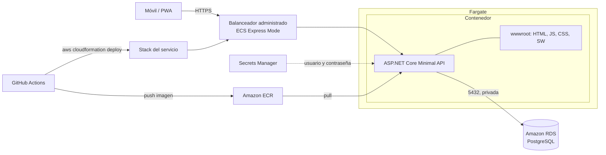

# Arquitectura

## Componentes
- **PWA (wwwroot):** interfaz en JS vanilla; el service worker cachea los archivos estáticos.
- **API:** expone los endpoints y contiene la lógica de rachas (`StreakCalculator`, función pura).
- **PostgreSQL:** persistencia fuera del contenedor, así los datos sobreviven a los redespliegues. En local y en CI corre en un contenedor (`docker-compose.yml`); en la nube, en Amazon RDS for PostgreSQL privada, sin acceso público y accesible solo desde las tareas del servicio. La contraseña la administra RDS en Secrets Manager y la tarea la recibe como secreto de ECS. La API aplica las migraciones al arrancar. Ver ADR-004. (El día 1 usaba SQLite en un archivo del contenedor.)
- **Contenedor:** una sola imagen con API y PWA.
- **Infraestructura:** definida como código en `infra/aws/` con CloudFormation: stack base, stack de la base de datos y stack del servicio (ver ADR-004 y ADR-005).

## Decisiones relacionadas
Ver [ADRs](../decisiones/).
