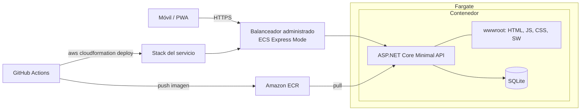

# Arquitectura

## Componentes
- **PWA (wwwroot):** interfaz en JS vanilla; el service worker cachea los archivos estáticos.
- **API:** expone los endpoints y contiene la lógica de rachas (`StreakCalculator`, función pura).
- **SQLite (día 1):** persistencia en archivo local del contenedor. En el día 2 se reemplaza por PostgreSQL (Supabase en la nube), ver ADR-004.
- **Contenedor:** una sola imagen con API y PWA.
- **Infraestructura:** definida como código en `infra/aws/` con CloudFormation: stack base y stack del servicio (ver ADR-005).

## Decisiones relacionadas
Ver [ADRs](../decisiones/).
