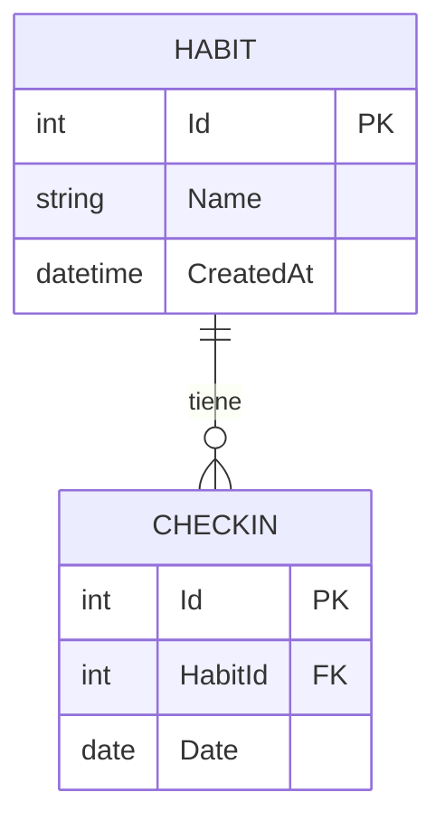

# Modelo de datos

## Reglas
- Un hábito no puede tener dos check-ins en la misma fecha (índice único `HabitId + Date`).
- Las fechas se guardan como **fecha sin hora** (`DateOnly`).
- Eliminar un hábito elimina sus check-ins (cascada).
- `DateOnly` se guarda como fecha en SQLite; en el día 2 se mapea al tipo `date` de PostgreSQL.
- El esquema se gestiona con migraciones de EF Core, versionadas en `Data/Migrations` (se regeneran al cambiar de proveedor).
