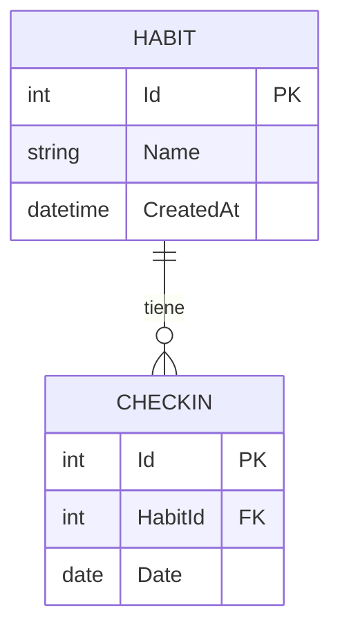

# Modelo de datos

## Reglas
- Un hábito no puede tener dos check-ins en la misma fecha (índice único `HabitId + Date`).
- Las fechas se guardan como **fecha sin hora** (`DateOnly`).
- Eliminar un hábito elimina sus check-ins (cascada).
- `DateOnly` se guarda con el tipo `date` de PostgreSQL y `CreatedAt` como `timestamp with time zone` (siempre en UTC). Los identificadores son columnas de identidad.
- El esquema se gestiona con migraciones de EF Core, versionadas en `Data/Migrations` y regeneradas al cambiar de SQLite a PostgreSQL. La API las aplica al arrancar.
