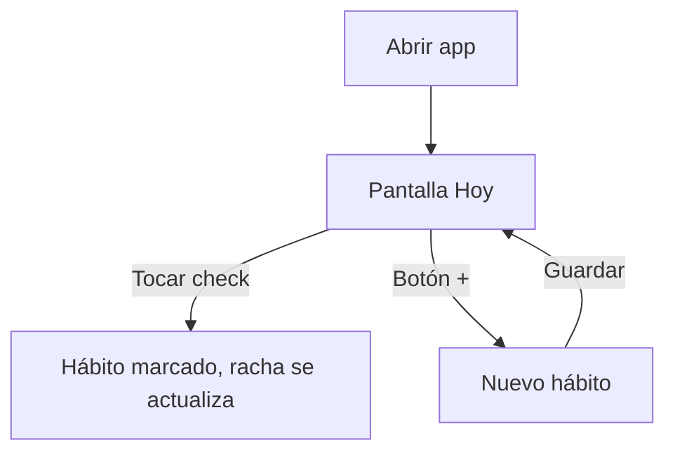

# UX

## Principios
- Una mano, pulgar: acciones principales abajo.
- Un toque para lo más frecuente (marcar hábito).
- Contraste alto y botones grandes.

## Pantallas
1. **Hoy:** lista de hábitos con check grande, racha 🔥 y mini-semana.
2. **Nuevo hábito:** campo de nombre y botón guardar.
3. **Detalle (opcional v2):** vista semanal y racha máxima.

## Flujo

## Pendiente
- Wireframes (boceto a mano o Figma).
- Paleta y tipografía.
